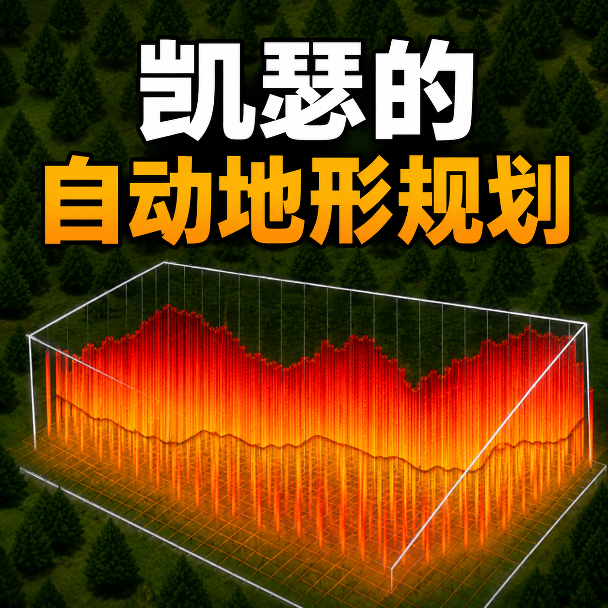

# ⛏️ 自动地形规划

*一矿一键，落子就停不下来。*

## 概览

Kayser 的自动地形标记（ATD）是《工业巨头》的一款体验优化（QoL）mod，能**为你的矿塔自动生成贴合矿体的采矿标记**。你不必再在结构复杂的矿床上手动一格一格地画标记——它会分析地形深度，沿着矿体的轮廓自动生成标记，省去手动放置、并不断补画的麻烦。

相关的附加功能包括：通道坡道、矿石构成分析、按矿塔设置挖掘优先级、区域杂物清理标记、手动转角标记，以及农田自动化整备。

所有矿塔设置都保存在原版存档中。该 mod 可随时加入或移出存档。100% 开源。

开矿愉快！

## 功能

- **生成采矿规划**：默认在后台线程扫描和规划，再一次提交完整方案。可在世界设置中让新任务改用游戏线程。
- **无矿塔挖掘**：可让未分配的挖掘机在矿塔范围外执行采矿规划。它们会调用符合条件的公共卡车，界面仍显示为未分配。默认关闭。
- **坍塌预览**：打开地形规划图层时，可查看现有采矿规划周边的预测坍塌范围。默认关闭。
- **过滤矿脉尖刺**：忽略原版矿脉中孤立而极细的尖刺，避免为少量矿石挖入大量基岩。
- **自动通路**：可生成坡道和带转弯的车辆通路，连接较深的作业区。
- **矿物组成**：估算当前采矿规划中的产物，包括挖掘基岩得到的岩石。
- **矿石分选厂外运**：设置兼容的外运路线、优先级和分配的卡车。
- **农地准备**：协助整平地面、填入表土，为建造农场做准备。
- **拐角规划**：在地形工具栏中手动放置外角、内角和平面拐角。

## 快速上手

1. 选中一座矿业控制塔。
2. 按需选择矿石筛选条件并调整矿塔设置。
3. 点击 **生成采矿规划**，扫描地形并放置规划。
4. 需要时，在模组的世界设置里启用无矿塔挖掘或坍塌预览。
5. 点击垃圾桶按钮，清除该塔生成的采矿规划。

需要《Captain of Industry》更新 4.3（0.8.8），内部版本 625 或更高。

模组可加入或移出现有存档。如果移除时无矿塔挖掘仍在运行，挖掘机铲斗或卡车里的临时货物可能丢失。

## 游戏截图

